

  

<h1 align="center">TGHub - Telegram 中文精选导航</h1>

  <b>精选优质 Telegram 中文群组、超级频道、实用机器人与新手实战指南</b>

  
  
  

---

**TGHub** 是一个开源的 Telegram 精选中文导航与索引仓库。只精选收录优质、活跃的中文社群、实用 BOT 机器人与应用，帮助用户发现优质内容。

推荐官网访问：**https://tgnav.com**

---

## 📑 快速目录导航

| 🤖 实用机器人 | 👥 频道与社群 (技术/工具) | 👥 频道与社群 (兴趣/生活) | 📖 推荐与指南 |
| :---: | :---: | :---: | :---: |
| [看剧影视与资源搜索](#看剧影视与资源搜索) | [数码科技与编程](#数码科技与编程) | [加密货币与 Web3](#加密货币与-web3) | [⭐ 特别推荐](#特别推荐) |
| [群组协助管理](#群组协助管理) | [软件 / 脚本 / 效率工具](#软件--脚本--效率工具) | [音乐音频与电台](#音乐音频与电台) | [优选推荐](#优选推荐) |
| [广告智能拦截](#广告智能拦截) | [新闻资讯与深度播客](#新闻资讯与深度播客) | [图片摄影与高清壁纸](#图片摄影与高清壁纸) | [常用中文语言包](#常用中文语言包一键安装) |
| [群组抽奖助手](#群组抽奖助手) | [AI 人工智能](#ai-人工智能) | [生活日常与消费](#生活日常与消费) | [新手教程速查](#新手教程速查) |
| [RSS 订阅推送](#rss-订阅推送) | [书籍读物与电子杂志](#书籍读物与电子杂志) | [影视娱乐与交流](#影视娱乐与交流) | [💡 提交收录](#提交收录) |
| [趣味与实用工具](#趣味与实用工具) | [游戏娱乐与电竞](#游戏娱乐与电竞) | [📜 开源协议](#开源协议) | [⚠️ 免责声明](#免责声明) |

---

## ⭐ 特别推荐 

| 图片 | 名称 | 简介 |
| :---: | :--- | :--- |
|  | [**SOSO搜索**](https://t.me/soso?start=a_6410041675) | 综合资源搜索一网打尽，全能搜索 |
|  | [**极搜**](https://t.me/jiso?start=a_6410041675) | 番号、磁力视频综合资源搜索 |
|  | [**快搜**](https://t.me/kuai?start=a_2Y0DFWA) | 热门视频综合资源搜索 |
|  | [**神马搜索**](https://t.me/smss?start=spread_6410041675) | TG中文导航搜索 |

## 优选推荐

| 名称 | 简介 |
| :--- | :--- |
|  [**段永平雪球动态实时推送**](https://t.me/xqdyp) | 实时监听推送段永平雪球动态与球友精选问答，掌握大佬的观点辅助判断。 |
|  [**你应该知道的那些事**](https://t.me/knowbig) | 网罗少有人知道的事，带你打破认知信息差。 |
|  [**内娱明星养眼图**](https://t.me/mingxinglive) | 每日精选内娱明星高清写真与红毯大片，纯粹养眼治愈。 |
|  [**加密撸毛交易所活动**](https://t.me/+dJJG2UZ0WF05MmQ1) | 聚焦 Web3 空投、交易所活动，赚钱快人一步。 |
|  [**今日x热点**](https://t.me/xhothot) | 快速播报热议爆帖，神评不断、猛料不停，带你紧跟全网风向！ |

## 🤖 实用机器人精选

### 看剧影视与资源搜索

| 名称 | 简介 |
| :--- | :--- |
|  [**阿里云盘搜索机器人**](https://t.me/aliyunshare_bot) | 汇聚全网最全资源，可以添加本机器人到任何群组 |
|  [**阿里云盘搜索机器人**](https://t.me/AliYunPanBot) | 集投稿、搜索、收藏、关注、分享和导出于一身，做Telegram 上更全能的阿里云盘资源机器人 |
|  [**一起搜电影**](https://t.me/sotv) | TG必备影视搜索神器，找到您喜欢的电影、电视剧！ |
|  [**YtbDownBot**](https://t.me/YtbDownBot) | 油管视频下载 |
|  [**IMDB查电影信息**](https://t.me/imdb) | IMDB查电影信息 |
|  [**utubebot**](https://t.me/utubest_Bot) | Youtube 视频免费下载机器人 |
|  [**getmediabot**](https://t.me/getmediabot) | 音乐搜索下载 |
|  [**VK Music Bot**](https://t.me/Vkmusic_bot) | 音乐搜索下载 |
|  [**多平台解析下载机器人**](https://t.me/freedlvideo_bot) | 支持Twitter / X、Instagram、YouTube、Facebook、Threads、Bilibili、抖音 / TikTok、微博、小红书、贴吧、微信公众号、快手、酷安、皮皮虾、最右、小黑盒 |
|  [**B 站解析**](https://t.me/bilibiliparse_bot) | 支持 B 站、抖音、小红书、Twitter、Instagram、YouTube 等多平台解析。 |
|  [**Stickerdownloadbot**](https://t.me/Stickerdownloadbot) | 下载贴纸为 jpg、png、webp 或 zip。 |
|  [**YouTube Downloader Music**](https://t.me/YoutubeDoBot) | 可帮助查找 YouTube 视频和音乐，支持多语言 |
|  [**网易云音乐下载**](https://t.me/Music163bot) | 支持网易云音乐下载 |
|  [**Music Downloader**](https://t.me/MusicDownloaderRobot) | Spotify 音乐下载 |
|  [**Music Downloader Bot**](https://t.me/songdl_bot) | 发送 Spotify、Gaana 等歌曲链接即可直接下载歌曲 |
|  [**Lyrics Bot**](https://t.me/find_lyrics_bot) | 发送你想要歌曲的歌词 |
|  [**支持多平台解析**](https://t.me/douyin_download_bot) | 支持 B 站、抖音、小红书、推特、Ins、FB、油管等解析 |
|  [**抖音 TikTok 视频图集解析**](https://t.me/DouYintg_bot) | 支持抖音、TikTok、X 推特、小红书等视频图集解析，支持去水印 |
|  [**多平台下载工具**](https://t.me/download_it_bot) | 支持大多数网站下载 |
|  [**妙妙小工具 Beta**](https://t.me/GLBetabot) | 支持多个平台和网站的下载功能，详细功能见官网 |
| 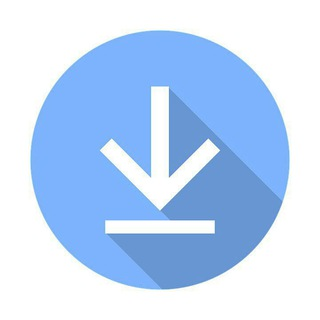 [**Video Download Bot**](https://t.me/VideoDownloadBot) | 支持下载 Facebook、Twitter、Instagram、VK 等 700+ 站点的视频 |
|  [**拿来吧你**](https://t.me/MediaSnagBot) | 破解群组/频道媒体转发限制，频道内容破解无限制 |

### 群组协助管理

| 名称 | 简介 |
| :--- | :--- |
|  [**验证机器人**](https://t.me/group_confirmation_bot) | 新人进组验证，四个汉字验证码 |
|  [**Pay Bot**](https://t.me/feeMasterBot) | 群拦截付费进群机器人,防止水军炸群 |
|  [**Combot**](https://t.me/combot) | 如果你有很多组 Telegram 可以帮助您完成管理它们的任务。 除了监控群组、通知您重要通知 |
|  [**TGCN-CAPTCHA加群验证**](https://t.me/tgcnjoincaptchabot) | 加群验证，杀广告 |
|  [**PolicrMini(beta)**](https://t.me/policr_mini_bot) | 自定义问题加群验证，代码开源 |
|  [**入群验证bot**](https://t.me/shieldy_bot) | 入群验证bot，英文的 |
|  [**加减法运算入群验证**](https://t.me/toorucaptchabot) | 一个用于加群验证的机器人 |
|  [**LittleGuardian**](https://t.me/littleGuardianBot) | 定时广播,分析群数据机器人，让你更好的掌握你的群聊信息情况 |
|  [**SangMata**](https://t.me/SangMata_BOT) | 放入群组可以监控群里用户名字更改记录 |
|  [**看门机器人Watch Door**](https://t.me/WatchDoorBot) | 可禁止发送指定类型的信息,用于避免恶意举报 |
|  [**FreqRobot**](https://t.me/freqrobot) | 限制群员发言频率 |
| 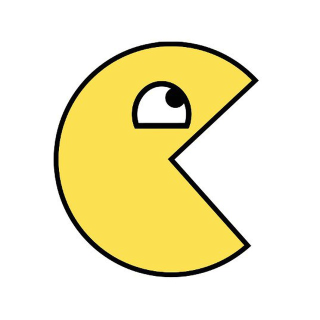 [**DaySandBox**](https://t.me/daysandbox_bot) | 删除进群24小时新人转发,图片等信息 |
|  [**WatchDog Robot**](https://t.me/watchdog_robot) | 删除特定类型的信息,例如链接,贴纸,图片,语音信息,文件等等 |
|  [**HushRobot**](https://t.me/HushRobot) | 禁止群聊天 |
|  [**joinhider_bot**](https://t.me/joinhider_bot) | 删除进群退群提示信息 |
|  [**No HelloRobot**](https://t.me/nohello_robot) | 删除欢迎信息 |
|  [**PowerBot**](https://t.me/jung2_bot) | 统计群组中用户的发言数 |
|  [**统计秘书**](https://t.me/FengStatsBot) | 群中各种统计，发言次数等 |
|  [**MasterTagAlert**](https://t.me/MasterTagAlertBot) | 管理通知 |
|  [**Dr.Web**](https://t.me/drwebbot) | 检查网页链接和文件，并在包含威胁时发出警告 |
|  [**AntiCommandBot**](https://t.me/AntiCommandBot) | 删除含命令消息 |
|  [**GrepRobot**](https://t.me/grep_robot) | 删除含有黑名单词的发言 |
|  [**Group Help**](https://t.me/GroupHelpBot) | 群管bot,除了常用的命令,还可以查看近期不活跃名单,设置关键字自动回复 |
|  [**AntiHyperlinkBot**](https://t.me/AntiHyperlinkBot) | 删除带链接消息 |
|  [**CaptchatBot**](https://t.me/Captchat_Bot) | 新成员验证码机器人，避免广告骚扰 |
| 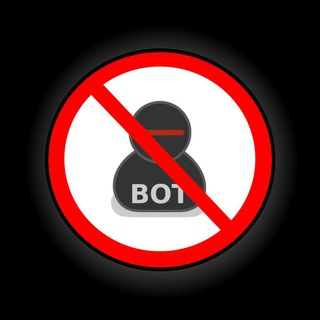 [**The Join Captcha Bot**](https://t.me/join_captcha_bot) | 入群验证机器人 |
|  [**NoAdsBot**](https://t.me/autodeletead_bot) | 自动删除群组中的广告消息 |
|  [**长消息杀手**](https://t.me/LongMessageKillerBot) | 最近长消息炸群很多，使用这个长消息杀手机器人可以防止炸群 |
|  [**Table of Contents Bot**](https://t.me/oglavlenie_shop_bot) | 为频道管理员生成并管理目录/导航索引 |

### 广告智能拦截

| 名称 | 简介 |
| :--- | :--- |
| 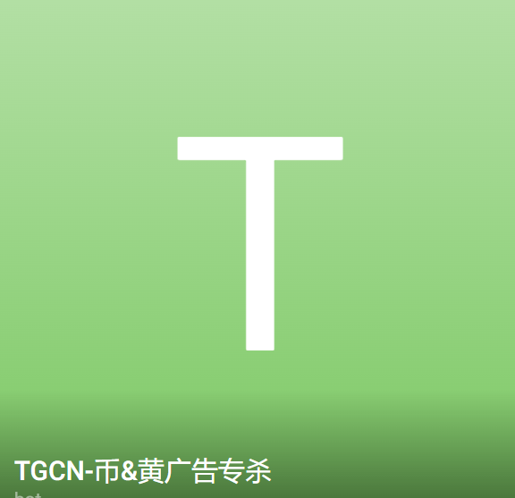 [**长名广告专杀**](https://t.me/adnamekillerbot) | 黄广告专杀 |
|  [**Auto Restrict Bot**](https://t.me/AutoRestrictBot) | 限制新群员 |
|  [**AntiServiceMessageBot**](https://t.me/AntiServiceMessageBot) | 删除进出群消息 |
|  [**LookOn 极速版1.6**](https://t.me/LookOnbot) | 广告杀手，协助群管理清除广告 |
|  [**广告终结者_Bot**](https://t.me/adzhongjiezhe_bot) | 广告终结者,通过设置关键字来删除违规消息 |

### 群组抽奖助手

| 名称 | 简介 |
| :--- | :--- |
|  [**抽奖助手**](https://t.me/LotteryHelperBot) | TG Bot之父专用抽奖机器人 |
|  [**抽奖助手机器人**](https://t.me/tgLotteryBot) | 抽奖助手机器人 |
|  [**抽奖秘书**](https://t.me/fengdrawbot) | 本机器人由峰哥开发，关注抽奖活动公布频道 |
|  [**Telegram抽奖助手**](https://t.me/cnLottery_bot) | 方便好用、公平公正的 Telegram 群组抽奖工具 |
|  [**抽奖机器人**](https://t.me/MyLuckyStar8_Bot) | 抽奖机器人 |

### RSS 订阅推送

| 名称 | 简介 |
| :--- | :--- |
|  [**RSS屋**](https://t.me/RSSWBot) | 提供全文RSS订阅源，还可以设置订阅关键字，具体可到他的官网查看 |
|  [**NodeRSSBot**](https://t.me/NodeRSS_bot) | 多语言支持，可自行docker部署 |
|  [**NodeRSSBot**](https://t.me/rssflowbot) | flowerss是一个支持应用内阅读的RSS机器人 |
|  [**EventsAggregatorBot**](https://t.me/EventsAggregatorBot) | 国外bot，在Telegram中转发您最喜欢的Twitter、Instagram、RSS、Reddit、YouTube、Twitch账户 |
|  [**Feed Man Bot**](https://t.me/FeedManBot) | 可以随时更新您的所有RSS订阅源，可以全文订阅，最多订阅50个youtube频道 |
|  [**RSSchina Bot**](https://t.me/RSSchina_bot) | rss 订阅机器人 |
|  [**GitHub**](https://t.me/githubbot) | 订阅公开 GitHub 仓库动态，并可直接在 Telegram 里评论 |
|  [**InviteMemberBot**](https://t.me/InviteMemberBot) | 付费频道/群的会员订阅平台 |

### 趣味与实用工具

| 名称 | 简介 |
| :--- | :--- |
|  [**DropMail.me**](https://t.me/DropmailBot) | 顾名思义是个临时的匿名邮箱，可以用来保护个人隐私和防止垃圾邮件 |
|  [**URL Uploader**](https://t.me/uploadbot) | 神奇的普通URL网址转TG档案，单个文件限制500M,每天限制1GB。如果想更多空间可以买VIP |
|  [**APK Downloader**](https://t.me/apkdl_bot) | 下载最新版本的任何免费安卓应用和游戏 |
|  [**如何与沙雕相处**](https://t.me/ruheyushadiaoxiangchu) | 投稿Bot： 友链： - 心惊。 |
|  [**GmailBot**](https://t.me/GmailBot) | 可以在这里就方便的收发 Gmail |
|  [**GIFDownloaderbot**](https://t.me/GIFDownloader_bot) | 直接发送GIF即可返回图片，保存相册即可 |
|  [**DownloadStickersBot**](https://t.me/DownloadStickersBot) | 导出整包贴纸。 |
|  [**stickersearchbot**](https://t.me/stickersearchbot) | 贴纸搜索。 |
|  [**StFindBot**](https://t.me/StFindBot) | 贴纸检索。 |
| 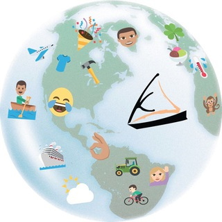 [**EmojiWorldBot**](https://t.me/EmojiWorldBot) | Emoji 工具。 |
|  [**Sticker Time Bot**](https://t.me/sticker_time_bot) | 每小时发送一张图片提醒时间 |
|  [**qrcrbot**](https://t.me/qrcrbot) | 二维码读取。 |
|  [**Anonymoustelegrambot**](https://t.me/Anonymous_telegram_bot) | 群组匿名消息机器人。将机器人加入群组后私聊机器人，可以通过机器人将文本、视频等匿名发送到群组内 |
|  [**Background Remover Bot**](https://t.me/BackGrndRemoverBot) | 可以为任何图片移除背景，并且完全免费，没有限制。 |
|  [**Comment Bot**](https://t.me/bakalztbot) | 频道消息添加点赞和评论按钮 |
|  [**Like and Comment**](https://t.me/LikeComBot) | 频道消息添加点赞和评论按钮 |
|  [**React Bot**](https://t.me/ReactBot) | 为频道帖子添加表情回应和评论 |
|  [**ID 查询机器人**](https://t.me/nminfobot) | 转发一条聊天信息给我，快速查询对方 ID |
|  [**ID 查询机器人**](https://t.me/username_to_id_bot) | 查询用户 ID、频道 ID、群组 ID |

---

## 👥 精选群组与频道

### 数码科技与编程

| 名称 | 简介 |
| :--- | :--- |
|  [**科技圈在花频道**](https://t.me/TestFlightCN) | 大家多多分享 •。 |
|  [**Duyao SpeedTest 科技生活 资讯转发**](https://t.me/DuyaoSS) | 不定期发布或转发一些资讯 测速。 |
|  [**Yummy**](https://t.me/GodlyNews1) | 本频道不定期推送科技数码类新资。 |
|  [**Shadowrocket News**](https://t.me/ShadowrocketNews) | Shadowrocket 只有。 |
|  [**科技&趣闻&杂记**](https://t.me/kejiqu) | 分享有价值，有趣的信息。 |
|  [** Apple Nuts**](https://t.me/AppleNuts) | 一个特别的 Apple 频道。 |
|  [**少数派sspai**](https://t.me/sspai) | 少数派 (sspai.com)。 |
|  [**上班划水之无聊图**](https://t.me/goworkbitch) | 活干完了吗。 |
|  [**科技圈的日常**](https://t.me/misakatech) | 科技圈内的大事小事 吹水群。 |
|  [**ISIS Watch**](https://t.me/IsisWatch) | This channel pu。 |
|  [**iBeta 尝鲜派**](https://t.me/ibeta_channel) | 苹果系统版本更新通知、功能变化与使用体验。 |
|  [**那些好看的Tg主题**](https://t.me/beautifultgtheme) | 分享一些好看的Telegram。 |
|  [**VPS信号旗播报**](https://t.me/vps_xhq) | VPS新闻频道。 |
|  [**Hacker News**](https://t.me/hacker_news_feed) | Top stories fro。 |
| 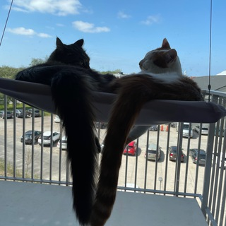 [**BennyThink’s Blog**](https://t.me/mikuri520) | 开发者的开源工具、技术折腾与生活随笔。 |
|  [**靠谱VPS推荐(默认带aff） - VPS仓/古博**](https://t.me/vpscang) | VPS推荐。 |
|  [**Arch Linux Chinese Messages**](https://t.me/archlinuxcn) | Arch Linux 中文相关。 |
|  [**GitHub Trends**](https://t.me/githubtrending) | See what the Gi。 |
|  [**网络安全笔记**](https://t.me/tsecrecord) | 网络安全研究、事件响应与 AI 安全资料分享。 |
|  [**即刻精选**](https://t.me/jike_collection) | 把即刻上最值得看的内容。 |
|  [**某科学的一个频道**](https://t.me/titan_pain) | 转发互联网上有趣的内容。 |
|  [**扫地僧º笔记**](https://t.me/lover_links) | 一种简洁观点。 |
|  [**电书摊**](https://t.me/telebookstall) | 愿客观主义照亮你的世界。 |
|  [**喵喵小喵喵**](https://t.me/MeowMiniMeow) | 大喵喵和小喵喵的转发频道 投喂。 |
|  [**全球VPS余量监控**](https://t.me/VPS_spiders) | 各网站各渠道监控爬虫合集，... |

### 软件 / 脚本 / 效率工具 

| 名称 | 简介 |
| :--- | :--- |
|  [**QX脚本收集**](https://t.me/NobyDa) | 提供各种自动化签到脚本 |
|  [**公益破解**](https://t.me/nbfz111) | 王者荣耀 和平精英 游戏外挂 辅助 破解软件 |
|  [**破解站—破解软件分享频道**](https://t.me/se8888888888) | 专注开车软件破解 白嫖党的福音 |
|  [**Widget🏂软件工具资源分享**](https://t.me/WidgetChannel) | 每日推送有用有趣的内容，包括但不限于：软件 工具 网站 科技新闻。 |
|  [**飞鱼资源分享**](https://t.me/feiyu123) | 分享一些工具，软件，网站,歌曲，互联网相关资讯，开源项目，碎碎念的想法 等等。 |
|  [**极客分享**](https://t.me/geekshare) | 专注分享各种高质量网站、工具、APP、开源项目等一切好玩的东西🚀，以及偶尔开开车🚗 |
|  [**APP喵-阿喵科技资源共享**](https://t.me/appmew) | 发现分享好用软件，优质资源，网站，极客，教程，网络黑科技 |
|  [**IOS优质应用**](https://t.me/ioskk) | 分享iOS、macOS限免信息，免费使用正版应用。分享iOS、macOS各种高效实用应用、破解脚本与实用黑技巧。 |
|  [**IOS宝藏**](https://t.me/iosrxwy) | 苹果越狱巨魔自签破解去广告插件软件➜宝藏资源、福利分享、圈X、Loon脚本 |
| 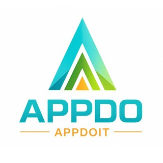 [**APPDO 数字生活指南**](https://t.me/appdodo) | 互联网/数码/App/羊毛/相。 |
|  [**Appinn Feed 小众软件**](https://t.me/appinnfeed) | 这里有小众软件和发现频道的内容。 |
|  [**乱七八糟的储物箱**](https://t.me/xyxyspace) | 本频道仅作为本人研究备份使用。 |
|  [**「 彼岸情报！」薅羊毛情报（网站/资源/软件/限免APP）见闻社**](https://t.me/BaccanoSoul) | 互联网优质羊毛资源共享集社。 |
|  [**不要糖醋放椒盐**](https://t.me/saltplayerupdate) | 椒盐音乐等播放器的版本更新、功能介绍与开发动态。 |
|  [**404 KIDS SEE GHOSTS**](https://t.me/isaiahsystem) | AI 工作流、笔记工具、开源应用与个人效率经验。 |
|  [**Leeco-雪花社**](https://t.me/xuehuashe) | 让雪花多些吧 分享实用快捷指。 |
|  [**推特翻译**](https://t.me/twitter_translate) | 近来有很多朋友来问询转发相关事。 |
|  [**TG规则脚本信息分享器**](https://t.me/MRHXPJGG) | 分享主题：包括但不限于关于机场。 |
|  [**Fragment Monitor**](https://t.me/Fragment_Monitor) | Fragment Monito。 |
|  [**App Store 应用推荐**](https://t.me/app_store) | 苹果应用商店的应用推荐、限免与降价信息。 |
|  [**小众软件**](https://t.me/niche_software) | Telegram 资源入口。 |
| 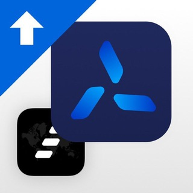 [**Quantumult X News**](https://t.me/QuanXNews) | 此频道用于发布 Quantum。 |
| 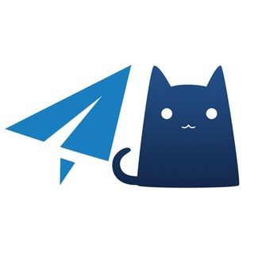 [**每日免费节点**](https://t.me/autofreevpn) | 每天中午12点准时刷新每日免费。 |
|  [**每日分享免费节点**](https://t.me/xianyuxmpd) | clash节点，v2ray节点。 |

### 新闻资讯与深度播客

| 名称 | 简介 |
| :--- | :--- |
|  [**知乎日报**](https://t.me/zhihuribao_rss) | 知乎日报实时推送 |
|  [**路透中文**](https://t.me/lutouzhongwen_rss) | 路透中文全文实时推送 |
| 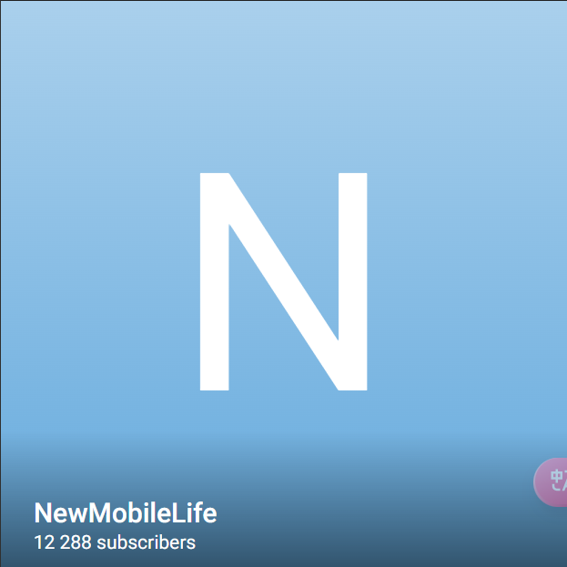 [**NewMobileLife**](https://t.me/newmobilelife) | 限時免費情報、Apple 消息、科技新知、實用秘技 |
|  [**Time经济观察**](https://t.me/TimeHorizonX) | 宏观经济/公共政策/金融市场 |
|  [**互联网从业者充电站**](https://t.me/https1024) | 内容多为技术、产品、设计、运营等不同话题内容；目标人群为程序员、设计师、产品经理、运营管理等不同职能。 |
|  [**校长读报**](https://t.me/XiaoZhangDuBao) | 多读书 多看报 |
|  [**Readhub**](https://t.me/readhub_cn) | 每天三分钟的科技新闻聚合阅读，内容主要包括商业动态、科技资讯，每天早 9 点推送当日早报。 |
|  [**ChatGPT / AI新闻聚合**](https://t.me/AI_News_CN) | OpenAI状态页通知 \| 汇集全网ChatGPT/AI新闻 |
| 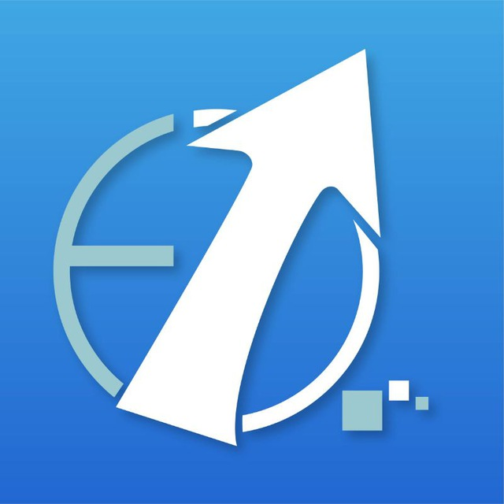 [**财经慢报**](https://t.me/Financial_Express) | 财经类资讯新闻频道，实时覆盖黄金原油外汇股票区块链市场，内容真实中立客观。 |
|  [**每天60秒简报**](https://t.me/NEWSPJAPK) | 新闻简报 热点时事 数码科技 社会民生 |
|  [**财联社VIP文章分享**](https://t.me/clsvip) | 财联社 VIP文章即时更新：盘中宝、风口研报、狙击龙虎榜、电报解读 |
|  [**风向旗参考快讯**](https://t.me/xhqcankao) | 风闻奏事，遍查访知。 |
|  [**电报时报**](https://t.me/times001) | 投稿点频道左下角对话图标。 |
|  [**华尔街见闻 - 财经时讯 AI 实时互动**](https://t.me/FinanceNewsDaily) | 中国领先的金融信息平台。 |
|  [**看新闻 学英语 双语新闻**](https://t.me/shuangyunews_rss) | 知乎日报 纽约时报 BBC中文。 |
|  [**科技爱好者周刊**](https://t.me/scitech_fans) | 记录每周值得分享的科技内容。 |
|  [**经济信息联播**](https://t.me/eco_cn) | 独立，个性的财经，金融资讯早报。 |
|  [**突发新闻**](https://t.me/breakingnews_t) | 突发新闻推送服务（简体中文）。 |
|  [**财经快讯**](https://t.me/fnnew) | 最新最全全球财经资讯24小时不。 |
|  [**NS新闻转报**](https://t.me/SwitchNewCN) | 官方信息请看。 |
|  [**主机百科资讯分享**](https://t.me/zhujiwiki_info) | 主机百科的主机类信息分享频道。 |
|  [**PlayStation 游戏资讯**](https://t.me/playstationnewssss) | PlayStation 游戏发售、版本更新与会员资讯转载。 |
|  [**Hana 的 CS 杂谈**](https://t.me/hanacs2) | CS 电竞赛事、战队变动与赛程资讯，含外语转载。 |

### AI 人工智能

| 名称 | 简介 |
| :--- | :--- |
|  [**AI探索指南**](https://t.me/aigc1024) | 关于ChatGPT、Bard等人工智能、思维方式、知识拓展，能力提升等 |
|  [**ailibrarya**](https://t.me/ailibrarya) | 分享 GPT Image、Midjourney、FLUX、Nano Banana、Grok提示词/Prompt与做图技巧,每周更新！ #人像 #广告 #插画 #二次元 #动漫 #COS🪧 AI趋势与工具情报站：@aipluscn🎬 AI+ ｜视频制作社区： @banyanAsia🤖 AI+｜机 |
|  [**skillslib**](https://t.me/skillslib) | 分享AI使用技巧、实战工作流、Skills、Agent，让你更好地把AI应用到工作&amp;生活中。 #ChatGPT #Claude #Grok #豆包 #千问🪧 AI趋势与工具情报站：@aipluscn🎬 AI+ ｜视频制作社区： @banyanAsia🤖 AI+｜机器人开发： @aist |

### 书籍读物与电子杂志

| 名称 | 简介 |
| :--- | :--- |
|  [**电子书/期刊**](https://t.me/sharebooks4you) | 下载各种最新期刊，例如《环球人物》 |
|  [**🔍搜书神器**](https://t.me/sosdbot) | 可能是TG最好的智能搜书机器人 |
|  [**杂志｜期刊｜考研**](https://t.me/Qikan2023) | 经济学人,纽约客,财新周刊,卫报,华尔街日报,中国日报,科学 |
|  [**國家地理雜誌中文版**](https://t.me/natgeomedia) | Hi 探險家，和國家地理一起探索世界吧！ |
|  [**读舍-享受阅读时光**](https://t.me/shufm) | 本群鼓励发起具体书的讨论、分享书摘与心得\|分享讲座、读书会等信息 |
|  [**小声读书**](https://t.me/what_youread) | 小声读书是一个探索数字阅读可能性和未来的开放项目，致力于打破信息茧房，挖掘价值信息。亦是一份杂志，一个博客，混搭不拘一格，时常荒腔走板。 |
|  [**宇宙自然博物馆**](https://t.me/manhuadao04) | 天文、地理与自然影像分享，更新节奏较慢。 |
|  [**Find Blog发现博客**](https://t.me/findblog) | 发现优秀的博客与创作者 发现博。 |
|  [**Leonn的博客**](https://t.me/liyuans) | 主要内容为低价主机资源。 |
|  [**APOD 每日天文图片（中文转载）**](https://t.me/apod_hans) | NASA APOD 天文图片与中文科普转载，非 NASA 官方频道。 |
|  [**椒盐豆豉剪报**](https://t.me/mtfront) | 个人博客、旅行、阅读与科技剪报，偶有理财话题。 |
|  [**豆瓣知乎简书微信公众号**](https://t.me/dbzhjs) | 阅读，爱上书。 |
|  [**好读-ReadFine交流总群**](https://t.me/ReadfineChat) | 频 道 @Readfine 交流群 @ReadfineChat 好读提供电子书一站式阅读体验，一键下载，享受读趣。在这里因为有您... |

### 游戏娱乐与电竞

| 名称 | 简介 |
| :--- | :--- |
|  [**原神**](https://t.me/YuanShen) | 本频道半自动推送《原神》官方活动信息、公告和宣传视频等 |
|  [**Steam快讯**](https://t.me/steamsteam) | Steam游戏快讯 |
|  [**瞎玩菌**](https://t.me/blindgamer) | 🕹 聚焦 PC / 主机游戏，分享游戏见闻，晒趣图，赏视频 |
|  [**TestFlightX**](https://t.me/TestFlightX) | Sharing TestFli。 |
|  [**你有一个打折需要了解**](https://t.me/SteamNy) | 可知： + 24 小时制（GM。 |
|  [**追尾游戏热点**](https://t.me/Vwyxrd) | 能聊与玩游戏真是太好了。 |
|  [**Epic 游戏限免提醒**](https://t.me/weeklyfreeepicgames) | Epic Games 正版游戏赠送活动与领取时间提醒。 |

### 加密货币与 Web3

| 名称 | 简介 |
| :--- | :--- |
|  [**BlockBeats**](https://t.me/theblockbeats) | 专业的区块链研究机构与资讯平台 |
|  [**Moonpulse 月律**](https://t.me/MoonPulse_Channel) | 抓住Web3脉动 |
|  [**币圈快讯**](https://t.me/btcnewsdaily) | 币圈快讯，掌握币圈动态 |
|  [**吴说区块链 新闻与深度**](https://t.me/wublock) | 吴说：接近真相。 |
|  [**PANews 投研资讯**](https://t.me/panewslab) | 提供加密货币和区块链领域有价值的资讯和深度洞察。加入讨论: t.me/PANewsLab订阅新闻: t.me/ChannelPANewsPA编辑部严选：t.me/PANewsSelected预测市场聪明钱监控：t.me/+5wXnvGdCEKcwN官网: PANewsLab.comAPP: pane |
|  [**深潮 TechFlow**](https://t.me/techflowpost) | 深潮 TechFlow 官方电报社群，独立思考、自由表达。Across the Great Wall we can reach every corner in the world。 |
|  [**Binance Killers**](https://t.me/BinanceKillers) | 🔥 Welcome to Our Free Channel 🔥Join VIP: t.me/BKConciergeBotSupport: t.me/BKCEOIG: instagram.com/binancekillerstradingTikTok: tiktok.com/@binance_ki |
|  [**Gateio**](https://t.me/gateio_zh) | 老牌数字资产交易平台 Gate.io 官方中文交流社群。 |
|  [**链捕手 ChainCatcher**](https://t.me/chaincatcher) | 主打深度、前沿的区块链品牌媒体。 |
|  [**加密快讯 Crypto News**](https://t.me/cryptonews_zh) | 提供最新的加密货币新闻、观点和市场动向的数据分析。 |
|  [**Binance Exchange**](https://t.me/binanceexchange) | Binance announcements: @binance_announcementsOther Languages: Please type /communities in the chat to find our other communities. |
|  [**BinanceChinese**](https://t.me/BinanceChinese) | 币安官方中文TG群 @BinanceChinese谨防假冒！私聊您的都是骗子⚠️所有涉及黄、黑、赌、灰、政治的话题都将被踢出群内禁止发布不实谣言及其他交易所截图请大家共同维护社区秩序，营造友好的讨论环境，谢谢！中文推特: twitter.com/binancezhDiscord: discord.g |
|  [**OKXGroup_CN**](https://t.me/OKXGroup_CN) | OKX公告频道：https://t.me/OKXAnnouncements_CNDiscord中文社区： https://discord.gg/hkCGKbbbqfOKX注册链接：https://www.okx.com/join?channelId=ACE505337本群为唯一官方指定中文社群 ，标 |
|  [**Bybit English**](https://t.me/BybitEnglish) | BYBIT is a trading platform that caters to the needs of all types of traders.Ann: https://t.me/Bybit_AnnouncementsHelp Center: https://i.bybit.com/1ws |
|  [**Gateio Official**](https://t.me/Gateio) | Top 3 Exchange \| 13 Years \| 52M+ Users \| 4,600+ Tokens🔸Trade: www.gate.com/trade🔸Signup to Win &#036;10,000: www.gate.com/rewards_hub💰Download App: |
|  [**Backpack 中文官方交流群**](https://t.me/BackpackExchangeSupportChinese) | Backpack 交易所官方中文社群，行情交流与在线客服支持。 |
|  [**Lighter 官方社区 (Lighter.xyz)**](https://t.me/lighterxyz_official) | Unofficial community chat for LighterSupport is only available via Discord. Join using the link below:https://linktr.ee/lighterxyz |
|  [**Wizz Radar**](https://t.me/groupdigest) | AI 精选群聊汇总 （内容来自多个中英文 crypto 社群） |
|  [**加密狗Web3共生群**](https://t.me/jiamigouclub) | 加密狗官方 Web3 社区交流与空投投研交流群。 |
|  [**Wizz 小时情报**](https://t.me/hourintel) | Wizz 精选加密情报小时级速递，追踪市场热点与链上异动。 |

### 音乐音频与电台

| 名称 | 简介 |
| :--- | :--- |
|  [**有故事的女同学**](https://t.me/WenAnGuan_botjihuo) | 网易云热评 欢迎加入云村 你往。 |
|  [**Classical Music**](https://t.me/exploreclassical) | 一起来听古典音乐吧～～。 |
| 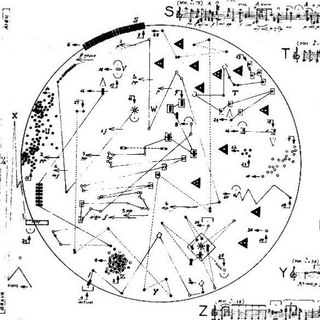 [**音乐小本本**](https://t.me/paulsnote) | 古典音乐欣赏、演奏分享与乐理随笔。 |

### 图片摄影与高清壁纸

| 名称 | 简介 |
| :--- | :--- |
|  [**公诸同好｜二次元美图分享**](https://t.me/gongzhutonghao) | 高质量二次元美图/插画作品分享 |
|  [**快乐星球**](https://t.me/botmzt) | 美女 妹子 精选 |
|  [**朱颜别镜**](https://t.me/meizitu3) | 全网美女,妹子图收藏。最是人间留不住,朱颜辞镜花辞树 |
|  [**PIXIV站每日**](https://t.me/pixiv_top50) | 搬運PIXIV每天綜合排行榜前50圖片資源 |
|  [**白丝即正义**](https://t.me/baisi) | 本频道会不定时推送一些绅士老爷们喜闻乐见的福利 |
|  [**每日少女壁纸**](https://t.me/SomeACG) | 平时会发一些自己精心挑选的壁纸，大多数来自Pixiv，主要以PC壁纸为主 |
|  [**每日少女壁纸**](https://t.me/kanxiaojiejie) | 街拍 妹子 福利 美女 摄影 性感 唯美 小姐姐 |
|  [**宝藏女孩**](https://t.me/BaoZang) | 芸芸众生，红颜各异，阅天下之美人，品世间之甜美。 |
|  [**少女实在是太美好了**](https://t.me/tastegirl) | 关于发布内容审美说明 简单说就。 |
|  [**Wallpapers And Art**](https://t.me/pfff_wall) | Beautiful pictu。 |

### 生活日常与消费

| 名称 | 简介 |
| :--- | :--- |
|  [**悟空的日常TG频道**](https://t.me/daily5kong) | 博客： 资源导航。 |
|  [**rvalue的生草日常**](https://t.me/rvalue_daily) | (可能位于火星的)大 草 原(。 |
|  [**笔记本：Lin's 文字世界 : 个人见闻/B站视频/网络见闻**](https://t.me/LinsBookA) | 频道始于2019年6月。 |
|  [**羊王频道 神价捡漏群**](https://t.me/yangwangpindao) | 共享ID 独享ID 兑换码ch。 |
| 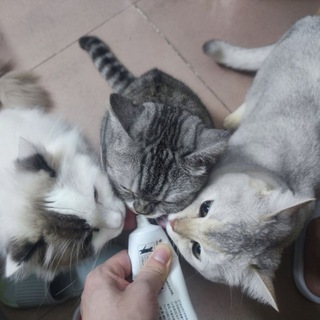 [**猫咪都是天使！**](https://t.me/mastemeow) | 以自家猫咪为主的日常记录与萌宠影像。 |
|  [**每日沙雕墙**](https://t.me/woshadiao) | 恕我直言。 |
|  [**树洞群友问有点意思**](https://t.me/ShortcutsCN) | 洞友频道投稿： （选择群友问投。 |
|  [**每天趣事**](https://t.me/Meitian) | 本频道内容： 多样沙雕冷笑话。 |
|  [**你不知道的冷知识**](https://t.me/knowledge1024) | 冷知识分享 有趣的，无趣的。 |
|  [**撸猫社**](https://t.me/lumaoshe) | 爱猫人士云吸猫特供。 |
|  [**音游沙雕频道**](https://t.me/yingyoushadiao) | 相关合作群组。 |

### 影视娱乐与交流

| 名称 | 简介 |
| :--- | :--- |
|  [**阿里云盘发布频道**](https://t.me/shareAliyun) | 最新高清影视资源，快速下载 |
|  [**电影频道**](https://t.me/cctv1) | 影视搜索动态及影视更新信息。 |
|  [**国产动漫**](https://t.me/guo_man) | 主要更新国产的动漫和电影 |
|  [**動漫花園 \| 新番推送**](https://t.me/dmhy_org) | 新番推送 |
|  [**高画质动漫分享**](https://t.me/YXHMd) | Anime share[爆肝中] |
|  [**无意识电波配送 确信**](https://t.me/justAboringchannel) | 的个人频道。 |
|  [**阿里、夸克、百度网盘4K影视资源**](https://t.me/Aliyun_4K_Movies) | 欢迎你来到4K影视频道。 |
|  [**4K影视屋(分屋）-蓝光无损电影**](https://t.me/dianying4K) | 广告建议。 |
|  [**懒狗集中营-115/阿里/百度/迅雷/夸克 影视分享 阿里云盘百度网盘115网盘**](https://t.me/vip115hot) | 建议，投稿，广告，合作。 |
|  [**人人影视字幕文件**](https://t.me/yyets_subtitles) | 片源可在在 rarbg.to。 |
|  [**啰哩啰嗦分享频道**](https://t.me/notonlyshare) | 一个克制的。 |
|  [**Galgame 频道**](https://t.me/Galgamer_Channel) | Galgame 资讯和推荐 你。 |
|  [**萌图志**](https://t.me/moepic) | 本频道会不定时推送一些二次元插。 |
|  [**瘦瘦的绘画世界**](https://t.me/drawing1024) | 记录自己的绘画作品 平时的素描。 |
|  [**阿里云高清视频**](https://t.me/aliyungaoqingshipin) | 阿里云盘分享交流频道，每个人在这里都可以找到和分享自己的资源 |

---

## 📖 Telegram 必备新手指南

### 常用中文语言包一键安装

| 语言版本 | 安装设置链接 |
| :--- | :--- |
| **简体中文 (Beta)** | [点击设置语言](https://t.me/setlanguage/zh-hans-beta) |
| **简体中文 (@zh_CN)** | [点击设置语言](https://t.me/setlanguage/classic-zh-cn) |
| **繁体中文 (香港)** | [点击设置语言](https://t.me/setlanguage/hongkong) |
| **繁体中文 (台湾)** | [点击设置语言](https://t.me/setlanguage/taiwan) |

### 新手教程速查

- [如何注册 Telegram 电报](./docs/knowledge/basic/register.md)
- [怎么设置中文语言包](./docs/knowledge/basic/language.md)
- [怎么添加好友与管理联系人](./docs/knowledge/basic/add-friend.md)
- [Telegram 常用名词解释](./docs/knowledge/basic/words.md)
- [如何创建群组与频道](./docs/knowledge/guide/group.md)
- [如何创建与配置机器人 BOT](./docs/knowledge/guide/bot.md)
- [新建分组收纳聊天会话](./docs/knowledge/guide/folder.md)
- [客户端多账号登录切换](./docs/knowledge/guide/add-account.md)
- [收不到短信验证码解决方案](./docs/knowledge/help/code.md)
- [怎么解除敏感内容限制浏览](./docs/knowledge/help/content-restrict.md)
- [账号封禁申诉解封方法](./docs/knowledge/help/find-account.md)

---

## 💡 提交收录 

请先star后提交issue，每周整理收录~

---

## ⚠️ 免责声明 

1. 本项目所有内容均收集整理自互联网公开渠道，仅供交流学习使用。
2. 请遵守当地法律法规，文明使用网络。
3. 若相关资源存在侵权或违规，请提交 Issue 通知我们处理。

---

## 📜 开源协议 

本项目基于 [MIT License](./LICENSE) 开源。
