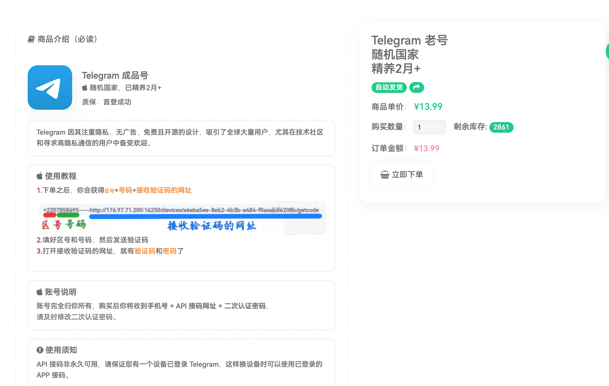

# 如何注册电报

要想注册使用电报，首先必须要有梯子，如果你还没有稳定可靠的梯子使用，可以[点击这里查看。](../../../docs/money/vpn.md)

准备好梯子上网后，接着我们需要下载电报软件

## 安卓用户

安卓用户手机浏览器[点击官网](https://telegram.org/android)直接下载 apk 安卓包（后续更新 app 内会有提示也可以直接下载完成更新）

## 苹果用户

苹果 iPhone 用户由于只能通过 App Store 下载软件，国内注册的 appld id 账号登录是无法搜索到电报的，我们需要先准备一个国外的 Apple id 账号，可以点击这里查看[如何获取国外 Apple id 账号](../../../docs/money/appid.md)。

准备好国外 Apple id 后就可以去 Apple store 登录，然后搜索 telegram 即可完成下载。

## 打开电报注册

电报是支持中国大陆用户手机号注册的，进入 APP 就可以使用手机号注册，直接输入手机号，然后等待验证码。需要注意的是，可能存在收不到验证码的情况，大家可以多试几次，也可以[参考点击这里](../../../docs/knowledge/help/code.md)排查问题

## 直接购买电报号

如果大家在注册的过程中，遇到奇奇怪怪的问题难以顺利完成，也可以直接通过一些平台购买电报号，可以[点击这个网站查看](https://tggsearch.shop?from=58418)。

