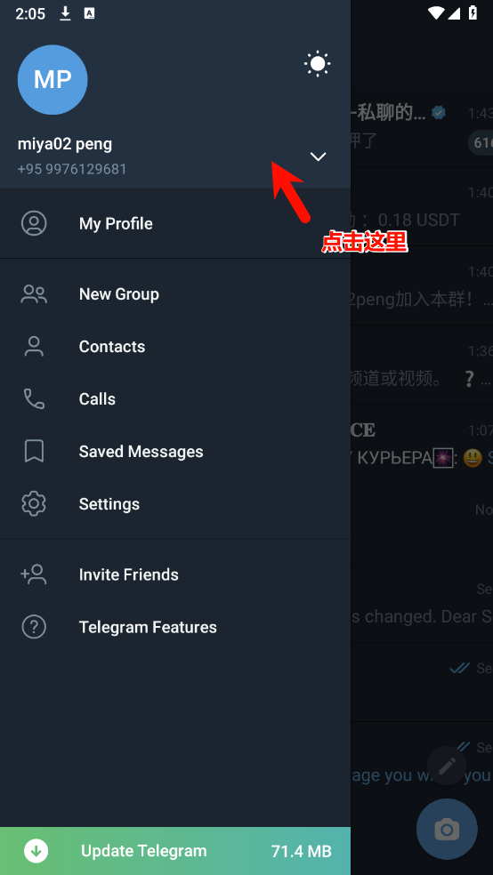
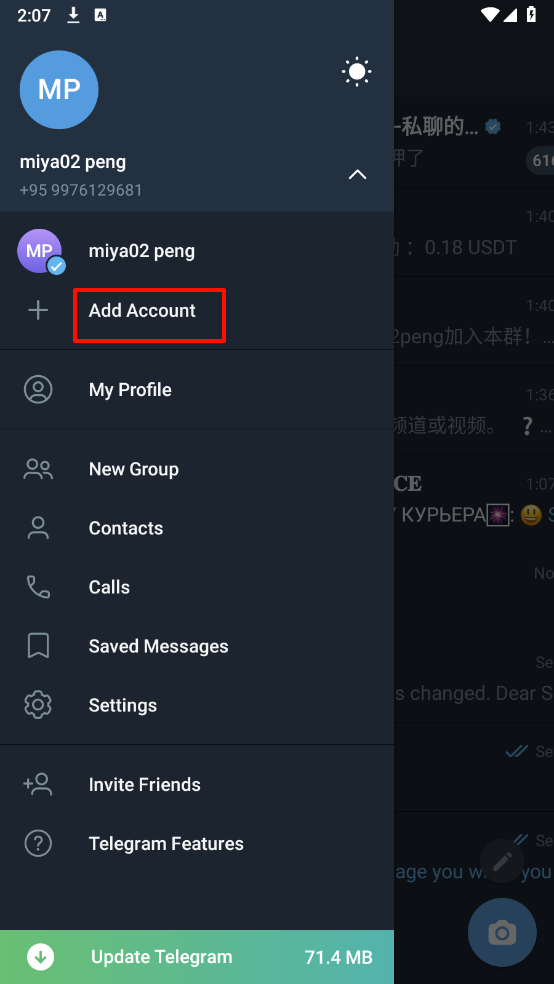

# 电报客户端登录多个账号

电报客户端支持登录多个账号，然后轻松切换账号使用，下面看下怎么使用。

## Android

点击左上角三短线->点击账号右侧下拉箭头->添加账号

  
  

## IOS

长按右下角设置按钮->添加账号->登录账号即可，可同时登陆 3 个账号

## macOS

- 右键或左键点击设置按钮->添加账号->登录账号即可。
- 右键或左键点击设置按钮->可以直接切换多个账号，也可以用多个客户端：Telegram，Telegram Desktop(Lite)。

## Windows

- 点击左上角三短线->点击账号右侧下拉箭头->添加账号。
- 客户端多开的方法：把目录中的 Telegram.exe 文件复制一份到另外一个文件夹，N 开都可以
