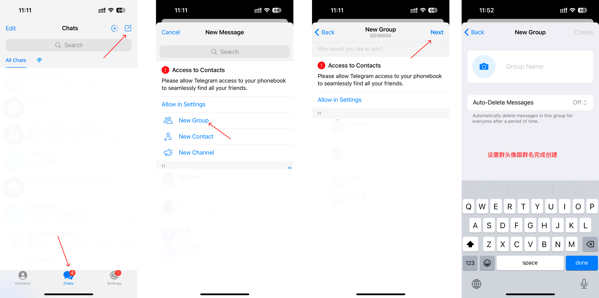
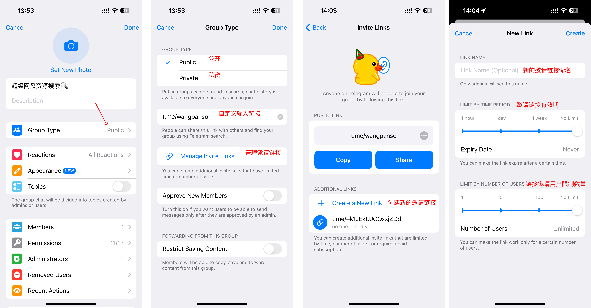

# 新建群组/频道

> Telegram电报如何新建群组、新建频道、新建机器人

## 新建群组(Group)/频道(Channel)

### 按钮入口在哪？

- iOS 客户端：对话->右上角最右边一个图标->新建群组
- Android 客户端：左上角三短线->新建群组
- Desktop 客户端：左上角三短线->新建群组
- macOS 客户端：主界面搜索框后面图标->新建群组

  群组与频道区别是什么？区别主要在于群组大家可以发消息，频道用户只能订阅查看消息。

### 操作流程

这里以 iOS 客户端创建群组为例（频道相似流程）：

新建完之后，我们点击刚刚创建的群可以修改配置。例如，可以将群修改为公开的（默认是私密的），这样任何人都可以通过链接直接加入群聊。同时，我们也可以创建多个邀请加入群聊链接，**自定义邀请链接失效日期以及限制通过邀请链接加入的人数。**

