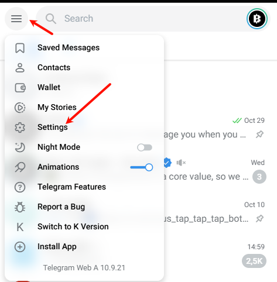
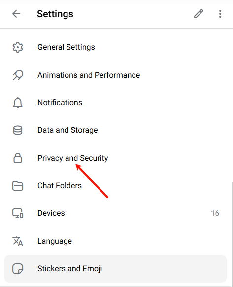
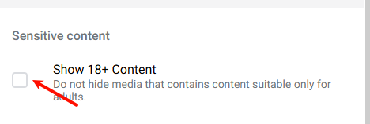

# 怎么解除敏感内容（黄色）限制浏览

> Telegram电报tg怎么解除敏感内容限制浏览


如果你进入某个群或频道遇到如下提示：

```
This channel can't be displayed because it was used to spread pornographic content.
```

这是因为 Apple 对未成年人保护的限制，其他客户端无此限制，可以正常进入群

## 具体原因

- 有人在群里发了色情内容，被人举报后，被 Telegram 官方限制了；
- Telegram 官方只会处理举报的，不会主动审查，如果没人举报就不会被限制；

## 解除方法

注意 ⚠️：解除方法限制通过电脑客户端或者网页版解除限制，**手机客户端暂不支持操作**。下面以网页版为例操作解除内容限制：

访问电报官网：[https://web.telegram.org/a](https://web.telegram.org/a)

登录后按照如下操作即可


  
  


接着把这个 ☑️ 上



操作完之后，手机端最好退出重新登录即可。

## 部分地区账号无法解除限制

巴基斯坦、哈萨克斯坦、伊朗、印度、印度尼西亚、马来西亚等地区的号码没有此选项，无法解除敏感内容限制；
