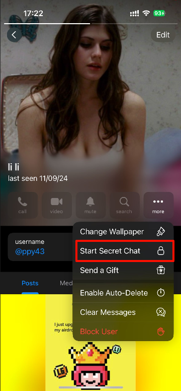

# 加密对话

> Telegram电报tg如何加密对话

## 什么是加密对话

加密对话适用于那些比普通人更想要保密的人，加密对话中的所有消息都使用端到端加密。这意味着只有您和收件人可以阅读这些消息，其他人都无法破译它们。除此之外，当您删除对话一方的消息时，加密对话另一方的应用程序也会被命令删除它们。

- 只能通过原始设备访问历史消息
- 可设置阅后即焚计时器，自动销毁消息或媒体文件
- 不能转发消息，不能编辑已发送的消息

## 如何开启加密对话

打开您要联系的用户的个人资料，点击更多->开始加密对话。（注意 ⚠️：网页版不支持）

> 请记住，Telegram 加密对话是特定于设备的。如果您在其中一台设备上与朋友开始加密对话，则该聊天将仅在该设备上可用。如果您退出，您将丢失所有加密对话记录。您可以根据需要与同一联系人创建任意多个不同的加密对话。

## 消息自毁

自毁计时器适用于加密对话中的所有消息以及私有云聊天中的媒体。

要设置计时器，只需点击时钟图标（iOS 上的输入字段，Android 上的顶部栏），然后选择所需的时间限制。当时间耗尽，该消息就会从两个设备上消失。如果对方截屏，您会收到通知。

> 请注意，加密对话中的计时器仅适用于设置计时器后发送的消息。它对较早的消息没有影响。

## 截图提醒

不幸的是，在某些系统上，没有一种万无一失的方法来检测屏幕截图。Telegram 会提醒您有关加密对话中截取的屏幕截图，但仍有可能绕过此类通知并静默截取屏幕截图。建议仅与您信任的人分享敏感信息，毕竟，没有人可以阻止人们使用不同的设备或老式相机拍摄屏幕照片。
