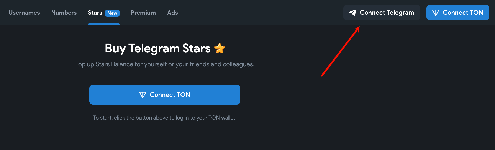
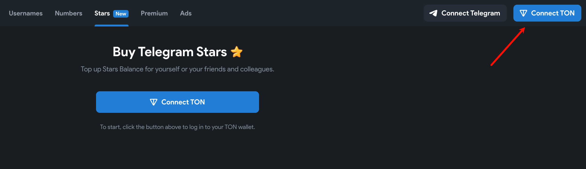
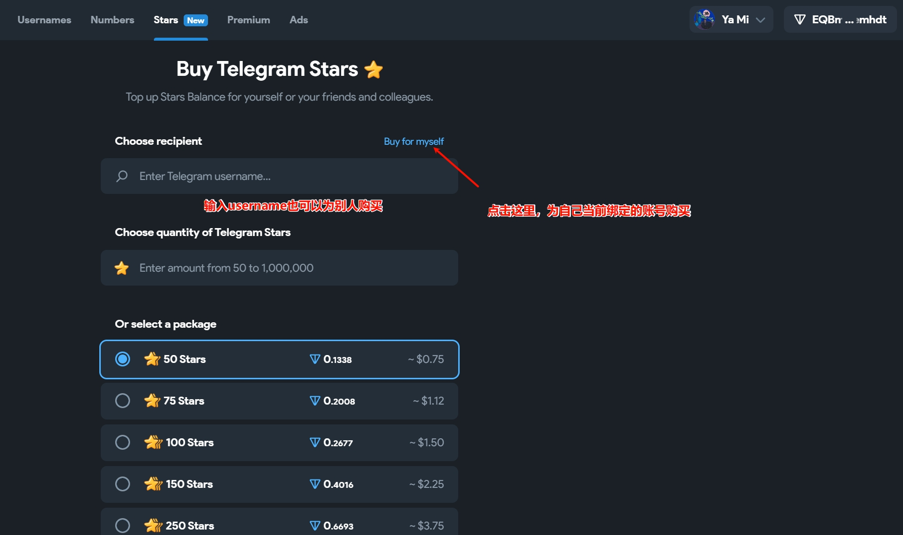

# Telegram star星币

> Telegram电报tg如何购买star星币、电报小游戏购买star 星币

## Telegram 星币是什么

你可以理解成类似 qq 的 Q 币，是电报内的一种支付货币。在玩电报游戏小程序或者付费查看帖子时，需要支付 star 才能完成解锁。
目前在玩电报空投小游戏时，经常会遇到此类需要支付星币才能解锁的功能。

## 如何购买 star 星币

如果通过 App 内置按钮点击购买，你需要有一张国外的信用卡，手机绑定后才能正常完成支付，相信的大部分人都没有。
这里介绍一个专门购买星币的网站[https://fragment.com/stars](https://fragment.com/stars)，价格还更优惠，**打了 7 折**。

> 注意的是，接下来的内容需要一定的加密货币知识

打开网站后，点击右上角 Connect Telegram 用电报登录

电报登录绑定后，接着点击右边的 Connect Ton 绑定钱包

这里给小白科普下：Ton 是电报的官方加密货币，已经在币安、bybit 等各大交易所上市，这里用的就是 ton 进行支付购买 star。
绑定钱包建议大家使用 tonkeeper，具体注册使用大家可以自行查阅相关资料。
准备购买的流程大概是，先在币安等交易所购买 ton 币，买完后转到 tonkeeper 钱包，接着完成购买 star。

准备好上面的钱包绑定后，页面长这样

这里有 star 数对应的 ton 价格数量，根据自己需要买的 star 数，去交易所购买相应数量的 ton 币，然后转到 tonkeeper 钱包即可完成支付。
