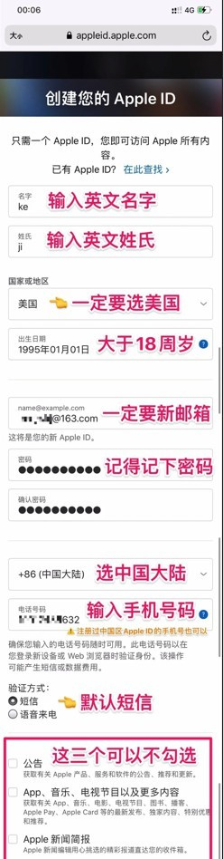
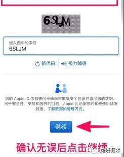
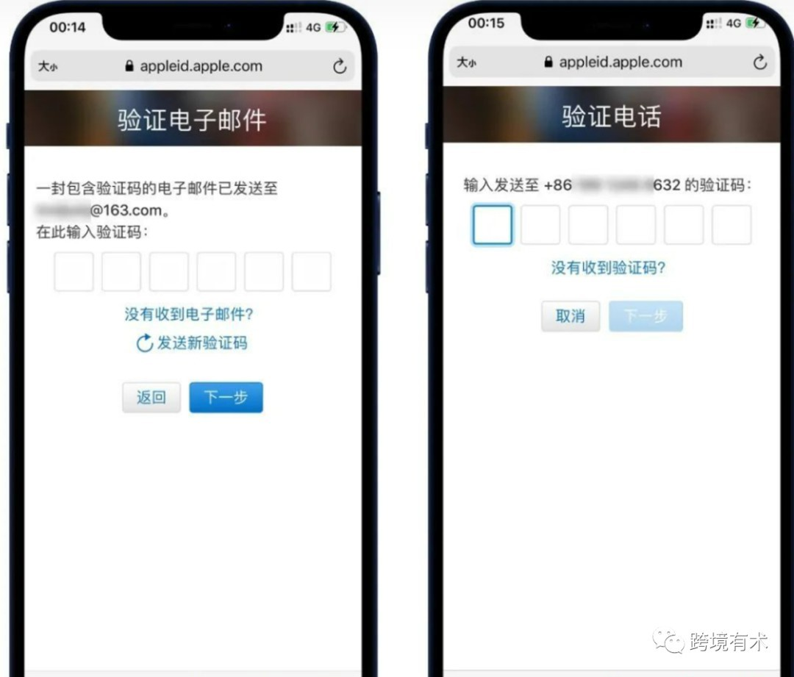
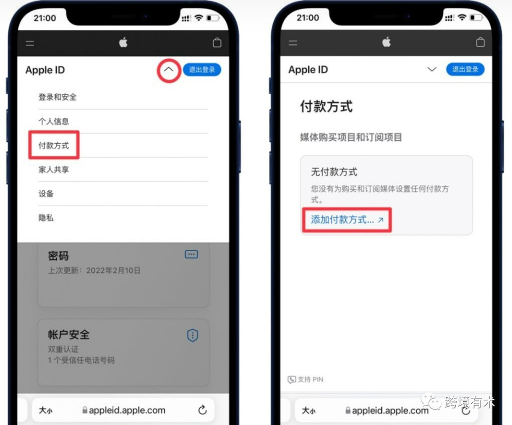
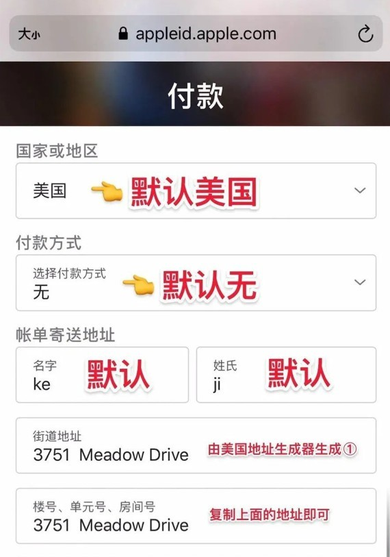
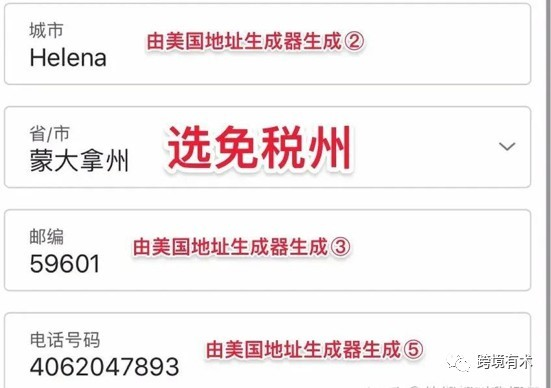
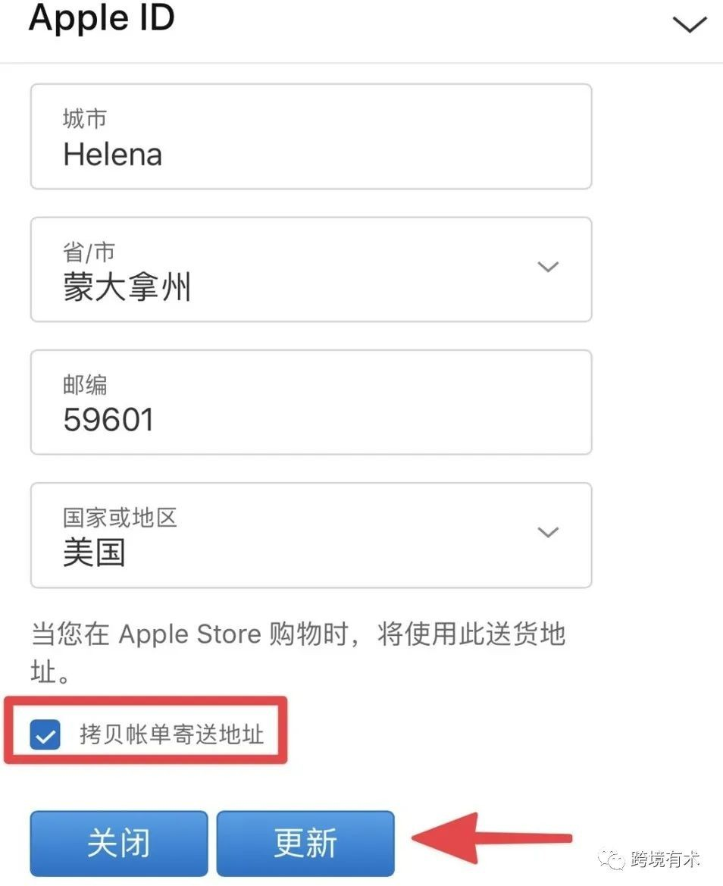

# 🔥 如何注册美区等其他国家AppleId

> 2024 免费最新美区香港新加坡台湾苹果 ID 账号注册教程

## 美国 Apple ID 注册登录教程详解(2026 免费最新美区苹果 ID 账号注册教程)

### 一、准备工作

1. 一个能接收短信的国内手机号
2. 一个全新邮箱（从未注册过 Apple ID 的邮箱）
3. 美国地址网址（下面会给出）

注意以下四点可以避免很多问题

1. 出生日期：一定要设置成大于**18**周岁的日期，否则会导致部分应用由于年龄限制无法使用。

2. 电子邮件：建议新注册一个全新的从未注册过 Apple ID 的邮箱，比如：163 邮箱、gmail 邮箱（本人一般用 gmail 邮箱）。

3. 手机号码：亲测，注册过中国区 Apple ID 的手机号码可以用来注册美区账号，**不会产生冲突**
   （小编有一个大陆的 ID、美区 ID、还有个香港 ID，用的都是同一个手机号）。

4. 密码：设置密码时，密码中不要包含有名字、生日、邮箱中的信息，否则会卡在验证码那一步，还要注意要有大小写字母。

### 开始注册

首先进入美国 Apple ID 注册页面，点击打开。[https://appleid.apple.com/account](https://appleid.apple.com/account)

具体注册方法如下长图，跟着步骤走就行了，一定要严格按照写的要求操作。

接着需要对电子邮件/手机号码进行验证。把收到的验证码输入进去，依次点击下一步就行了

注册成功后，账号会自动登录，如果没登录的话重新登录一遍刚注册的账号即可。

接着点击退出登录左边的“箭头”然后点击付款方式，接着再点击添加付款方式。

下一步是填写付款方式&账单地址，这步很关键，需要借助美国地址生成器网站，它会自动帮你生成街道地址、城市、邮编、电话号码等信息。

生成地址前，建议选以下五个免税州：蒙大拿州（Montana）俄勒冈州（Oregon）阿拉斯加州（Alaska）特拉华州（Delaware）新罕布什尔州（New Hampshire）

### 美国地址生成器网址

- 网址一：[https://www.meiguodizhi.com/](https://www.meiguodizhi.com/)
- 网址二：[http://www.haoweichi.com/](http://www.haoweichi.com/)
- 网址三：[https://www.shenfendaquan.com/](https://www.shenfendaquan.com/)

将美国地址生成器生成的内容直接复制粘贴到对应的栏筐中，如下图所示。

接着勾选拷贝账单寄送地址，最后点击更新就行了。

**恭喜大家美区 ID 注册成功了。**

**同样的操作方式，大家也可以注册其他国家地区的，只需要美国地址的填写换成其他国家就行。**

## ✨ 相关电报群推荐

  > 💡 **推荐关注**：[**玩转web3**](https://t.me/playwithweb3) - 专注分享币圈空投教程及任务提示，欢迎关注一起搞钱！
