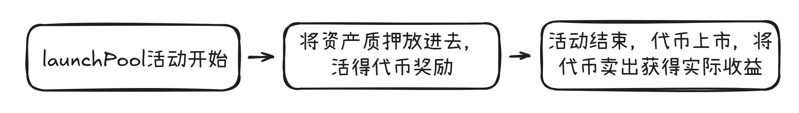
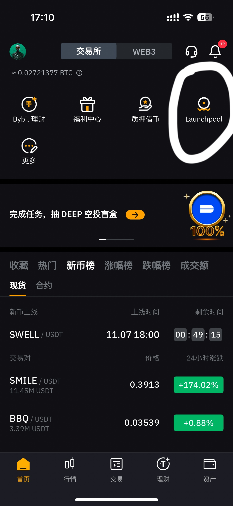
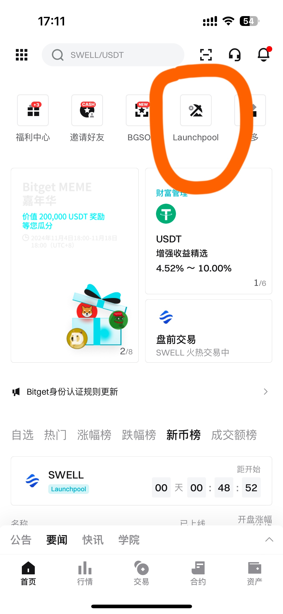
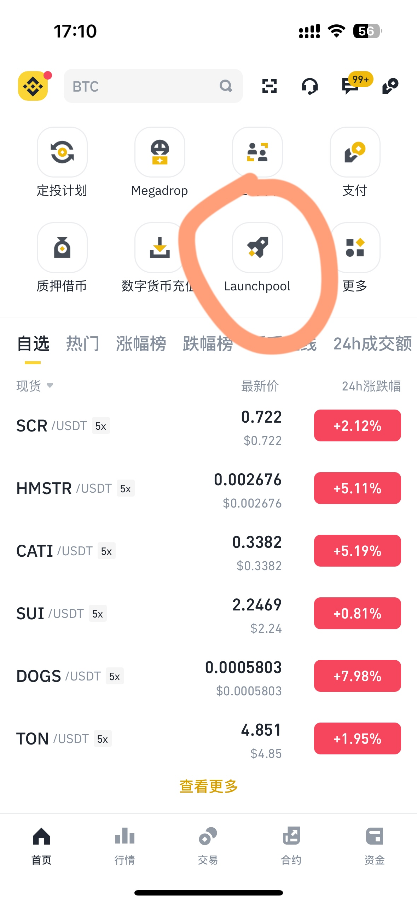
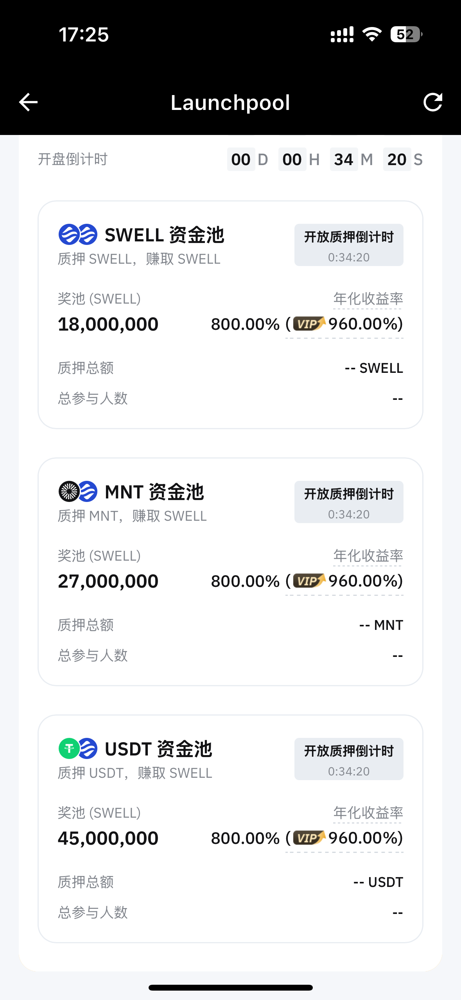

# 🪙 交易所如何理财赚超高年化收益

> 2024最新加密货币交易所理财赚取超高年化收益教程

import { laoyangweb3 } from '../../data/my-tg'

## 交易所如何理财赚超高年化收益

许多人注册完交易所之后，看到一些币可能涨幅特别惊人，就忍不住想要充钱进去买一些币试试。

这时候一定要记住，炒币的风险极大，甚至很可能短时间内本金亏完，所以十分不建议（尤其是新手）直接通过炒币的方式赚钱。

这里有一种十分安全的理财方式，可以做到无风险理财，赚取高年化的收益，那就是平台的 LaunchPool 活动。

这里稍微解释下 LaunchPool 活动是什么意思：

**Launchpool 是一种加密货币和区块链项目的融资和投资机制，通常用于新项目的代币发行。它允许用户通过质押（staking）现有的加密资产来获得新项目的代币。**

简单来说就是当有 LaunchPool 活动的时候，用户可以将自己的资产（例如 USDT）放进去，一般质押时间在 3 到 5 天时间，然后就会给你发放一个新币的奖励，你可以理解为利息。
发放领到的代币一般都在活动结束后的一两天内上市，这时候你就可以将代币卖出去。由于是平台官方的活动，可以说是**稳赚不赔**的。

## 活动多吗？收益如何

按照目前情况，每个平台每个月至少有一次 LaunchPool 活动（通常不止一次）。如果你看了[交易所注册](../../docs/money/cex.md)推荐常用的 4 个交易平台，这意味着你一个月起码有 3 次（欧易不支持）参加机会，所以还没注册的建议把这几个平台都注册下。

收益的话，取决于你的本金多少。为方便你对 lanchpool 活动收益的了解。这里按照年化 50%，活动持续时间 5 天，计算不同本金能获取到的收益情况。

| 本金（USDT） | 5 天收益(人民币) |
| ------------ | ---------------- |
| 500u         | 23.36            |
| 1000u        | 46.73            |
| 2000u        | 93.46            |
| 5000u        | 233.65           |

上面可以看到，如果想获得还不错的收益，建议起码投入 2000u，也就是人民币大概 15000 左右的成本，这能让你每次参加活动收益 ¥100，一个月大概获得 ¥300 左右的收益。

如果你有足够本金，活动收益也就随着你的本金增加而增加。

> 但这里要注意的是，平台 LaunchPool 活动质押一般有限制额度，通常是 2000u

这里笔者根据自身参加过多次的情况，总结了下各平台 LaunchPool 活动的特点：

| 交易平台 | 通常质押的币种   | 质押限额                                            |
| -------- | ---------------- | --------------------------------------------------- |
| 币安     | USDT、FDUSD、BNB | u/fdusd 池：2000，BNB：额度很大，普通用户等于无限制 |
| bybit    | USDT、MNT        | u 池：2000u，MNT：大概 2800u                        |
| bitget   | USDT、BGB        | u 池：2000u，BGB：大概 22000u                       |

如果你准备存入大额参加此类活动套利，通常建议借用朋友或者家人的身份注册多几个平台账号，就可以吃到多份收益。

## 活动入口在哪

不同平台入口都一样，入口名字就叫 LaunchPool，通常在首页就可以找到。如果首页没有找到，可以直接搜索 🔍

  
  
  

## 怎么操作

上面提到入口，点击进去就能看到参加页面，这里以 bybit 页面举例。

这张截图，是活动还没开始的状态，等活动时间开始之后，就可以将代币质押进去即可。

这里可以看到一共有三个池子 USDT，MNT 及 SWELL 的池子，通常对于新手来说参加 USDT 的池子即可。

但是如果说你有很多的资金，也可以通过借贷 MNT 的方式参与，通常活动的年化是要远高于借贷 MNT 产生的利息，所以依然存在获利的空间。对此有兴趣的，可以点击下方免费入群了解如何借贷参与。

   > 💡 **推荐关注**：[**老杨币圈理财**](https://t.me/laoyangweb3) - 专注币圈高年化理财活动，相信复利的力量！

## 利息代币多久发放

不同平台利息发放时间有所差异，币安及 bitget 在你质押进去开始后，通常是每小时发放一次利息代币。bybit 则是一天一次，通常是早上 8 点半左右发放一次。

## 发放的利息代币有必要持有吗

按照以往的活动情况来看，发放的代币都不具备投资价值。建议大家蹲点，在代币上市的时候直接到点卖出，最大化保证获得好的收益。

## 除了这个，还有别的高年化活动吗

有。这个就在各个平台的理财页面可以找到。币安不定期会有超级年化活动，通常高达300%。其他平台也有类似的高年化收益，大家可以自己平时多点击进去看看，或者查看平台消息通知。
