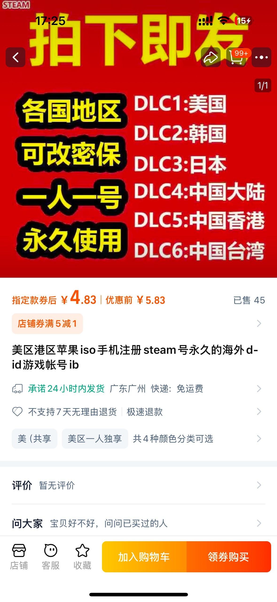

# 🏦 加密货币交易所注册

> 币安注册、bybit注册、bitget注册、欧易注册

import { binanceUrl, bitgetUrl, bybitUrl, okcUrl, binanceApkUrl, bybitApkUrl, bigetApkUrl, okxApkUrl  } from '../../data/article-const'

import { laoyangweb3 } from '../../data/my-tg'

## 加密货币交易所注册

在[电报如何赚钱](../../docs/money/index.md)中提到，通过参与玩小游戏获得的游戏代币奖励，需要通过交易所卖出换成 USDT，最后换成人民币。下面带大家了解常用的交易所，以及如何完成注册。

## 国人常用加密货币交易所

| 排名                | 成立时间 | 介绍                                                                                           |注册地址|
| ------------------- | -------- | ---------------------------------------------------------------------------------------------- | :---------------------------------------------------------------: |
| **币安（Binance）** | 2017 年  | 全球最大的加密货币交易所，用户资产安全最有保障，支持**微信支付宝**入金，用户界面简洁友好       |               [🔗去注册](https://accounts.suitechsui.cc/register?ref=890509025)|
| **Bybit**           | 2018 年  | 专注于主流加密货币的衍生品交易，如期货、期权等，经常有高年化（30%以上）理财活动可以参加                         |               [🔗去注册](https://www.bybitglobal.com/invite?ref=NZGKJLB)|
| **欧易（OKX）**     | 2014 年  | 社区活跃度高，积极与全球加密货币爱好者互动，会定期举办各类线上线下活动                         |               [🔗去注册](https://cnouyi.co/join/38953873)|
| **Bitget**          | 2018 年  | 跟欧易类似，专注于加密货币衍生品和现货交易的交易所，可以查看盘前行情，理财活动大部分只针对新人 |   [🔗去注册](https://www.bitget.fit/zh-CN/referral/register?clacCode=0VTVSH48&from=%2Fzh-CN%2Fevents%2Freferral-all-program&source=events&utmSource=PremierInviter)|

## 注册门槛

以上四个交易所大陆用户都可以**无门槛**注册，唯一必须用到的工具是需要用到梯子科学上网。
{/* 大家如果还没有自己常用稳定的🪜梯子，可以[点击这里](../../docs/money/vpn.md)跳转查看（仅供参考）。 */}

## 如何注册使用

建议大家统一使用使用谷歌邮箱（Gmail）方式注册。注册的时候，务必保管好自己的密码。
需要注意的是，注册完之后还不能正常使用，需要完成KYC验证。

**那什么是KYC认证呢？**

KYC（Know Your Customer，了解你的客户）认证是一种金融行业的合规程序，旨在验证客户的身份，以防止欺诈、洗钱和其他非法活动。KYC 是反洗钱（AML）和反恐怖融资（CFT）法规的一部分，广泛应用于银行、金融机构、加密货币交易所和其他需要客户身份验证的行业。

完成KYC认证需要用到你的**身份证**及**人脸识别**，这一认证操作是同时进行的，所以建议大家先在电脑端完成邮箱账号注册，接着在手机端下载App登录，继续完成KYC操作。

## 如何下载App

### iPhone用户
由于iPhone用户只能通过App Store下载软件，但是国内AppId（云上贵州）账号登录是搜不到以上交易所的软件。所以我们需要先注册个国外的Apple Id账号。

那么，价值几块钱干货来了🤪！

可以看到淘宝是有人专门卖国外Apple Id的账号，价格就几块钱。但是呢，我们其实可以完全自己免费注册。

这里建议大家自己去注册，因为淘宝买的账号绑定的不是你自己的邮箱跟手机，只能临时应急下载一些付费软件之类的，不能保证长久使用。而通过App Store下载的软件后续更新的话，也需要通过当时登录的Apple Id账号下载，所以用自己注册的号更为稳妥些。

这里专门写了详细教程，保证大家按照教程就能完成注册，详细教程请移步[点击这里](../../docs/money/appid.md)查看

### 安卓用户

安卓用户可以直接在官网点击下载，这里也帮大家整理了下，点击去官网下载就可以了

| 交易所                | 官网下载地址 |
| ------------------- | -------- |
|  **币安（Binance）** | [🔗去下载](https://accounts.binance.com/zh-CN/register?ref=890509025) |
 **Bybit**          | [🔗去下载](https://www.bybit.com/zh-MY/download) |
 **欧易（OKX）**    | [🔗去下载](https://www.okx.com/zh-hans/download) |
 **Bitget**          | [🔗去下载](https://www.bitget.com/zh-CN/download?channelCode=SSSS&vipCode=s1pz&groupId=230932&signup_source=index) |

 ### 加入电报交流群

 由于每个人的知识理解跟动手能力有所差异，大家如果在注册过程中遇到问题，欢迎点击下方加入电报群交流👏。

   > 💡 **推荐关注**：[**老杨币圈理财**](https://t.me/laoyangweb3) - 专注币圈高年化理财活动，相信复利的力量！
